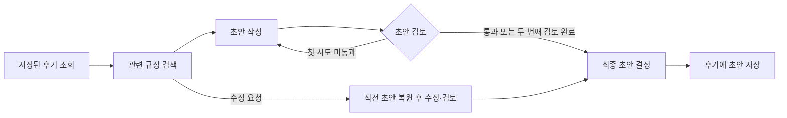

# 코딩 학원 수강 후기 API

수강 후기와 관련된 **학원 규정을 검색하고**, 그 근거를 바탕으로 AI가 강사 답글 초안을 작성합니다. 생성 과정을 실시간으로 확인하고, 저장된 초안은 수정 지시를 보내거나 직접 편집할 수 있습니다.

**Python 3.14 · FastAPI · LangChain · LangGraph · Chroma · OpenAI Responses API**

## 답글 생성 흐름



- **규정 근거와 후속 조치** — Chroma에서 관련 규정을 검색해 초안 작성·검토·수정에 활용합니다. 작성은 최대 두 번이며, 검토에서 근거 없는 약속이 남으면 담당자 확인 안내로 바꾸고 `needsFollowup`을 `true`로 표시합니다. [실습용 규정집](docs/policies/academy_policy.md) · [답글 그래프](app/services/reply_graph.py)
- **비동기 실행과 SSE** — FastAPI 시작 시 답글 그래프와 검색기를 초기화합니다. 일반 응답은 `ainvoke()`, 스트리밍은 `astream()`을 사용합니다. 스트리밍 중에는 초안 작성 토큰이 전달되고, 최종 답글은 저장 후 `done` 이벤트로 전달됩니다. [앱 초기화](app/main.py) · [답글 서비스](app/services/reply_service.py)
- **후기별 초안 수정** — `InMemorySaver`는 `reviewId`별로 직전 답글을 기억합니다. `PATCH`로 편집한 내용이 있으면 AI가 그 버전을 기준으로 수정합니다. 답글 생성이나 AI 수정 중 모델 호출에 실패하면 기존 초안이 유지됩니다. [답글 서비스](app/services/reply_service.py) · [API 테스트](tests/test_reviews_api.py)

서버 재시작 시 후기·초안·체크포인트가 초기화됩니다. 규정과 임베딩 모델이 동일하면 디스크에 저장된 Chroma 인덱스를 재사용합니다.

## API

| 메서드 | 경로 | 성공 | 오류 |
|---|---|---|---|
| `POST` | `/api/reviews` | `201` 후기 등록 | `422` 입력 검증 실패 |
| `GET` | `/api/reviews` | `200` 후기 목록, 선택적으로 `?rating=2` | `422` 유효하지 않은 별점 필터 |
| `GET` | `/api/reviews/{review_id}` | `200` 후기와 `replyDraft` | `404` 후기 없음 |
| `POST` | `/api/reviews/{review_id}/reply` | `200` 초안 생성·저장, `reviewId`·`reply`·`model`·`tone`·`needsFollowup` 반환 | `404` 후기 없음, `502` AI 요청 실패 |
| `POST` | `/api/reviews/{review_id}/reply/stream` | `200` SSE `attempt` → `token` → `done` | `404` 후기 없음, 시작 이후 AI 요청 실패는 `error` 이벤트 |
| `POST` | `/api/reviews/{review_id}/reply/revise` | `200` 수정 지시를 반영한 초안 저장·반환 | `404` 후기 없음, `409` 생성된 초안 없음, `422` 빈 지시, `502` AI 요청 실패 |
| `PATCH` | `/api/reviews/{review_id}/reply` | `200` 직접 수정한 초안 저장·반환 | `404` 후기 없음, `422` 빈 초안 |

### 요청 예시

`POST /api/reviews`에 환불 문의가 담긴 후기를 등록합니다.

```json
{
  "studentName": "김수강",
  "rating": 2,
  "content": "수업을 두 번 들었는데 수강을 취소하고 싶어요. 전액 환불이 가능한가요?"
}
```

받은 `reviewId`로 답글을 생성합니다. 일반 생성과 스트리밍 요청에는 본문이 필요 없습니다. 아래 명령의 `1`을 실제 ID로 바꿉니다.

```powershell
curl.exe -N -X POST http://127.0.0.1:8000/api/reviews/1/reply/stream
```

서버의 `[학원 규정 검색]` 로그에서 검색된 조항을 확인합니다. 재작성이 시작되면 `attempt` 이벤트가 다시 오며, 최종 답글은 `done` 이벤트의 `reply`와 후기 조회의 `replyDraft`에서 확인합니다. 생성 후 `POST .../reply/revise`에 `{"instruction": "한 문장으로 줄여 줘"}`를 보내거나 `PATCH .../reply`에 `{"replyDraft": "수정할 답글"}`을 보내 직접 편집합니다.

## 실행 및 테스트

```bash
uv sync --locked
uv run fastapi dev
```

API 명세는 [Swagger UI](http://127.0.0.1:8000/docs)에서 확인합니다.

- **가짜 모드** — API 키가 없거나 `FAKE_LLM=true`이면 키워드로 규정집을 검색하고 정해진 문장으로 답글을 만듭니다. 네트워크 연결 없이 전체 흐름을 테스트할 수 있습니다.
- **OpenAI 모드** — `FAKE_LLM=false`와 유효한 `OPENAI_API_KEY`를 설정합니다. 기본 답글 모델은 `gpt-5.4-mini`, 임베딩 모델은 `text-embedding-3-small`입니다. Chroma의 기본 저장 위치는 `.chroma/`입니다. [환경 변수 예시](.env.example)

```bash
uv run pytest -q
```
